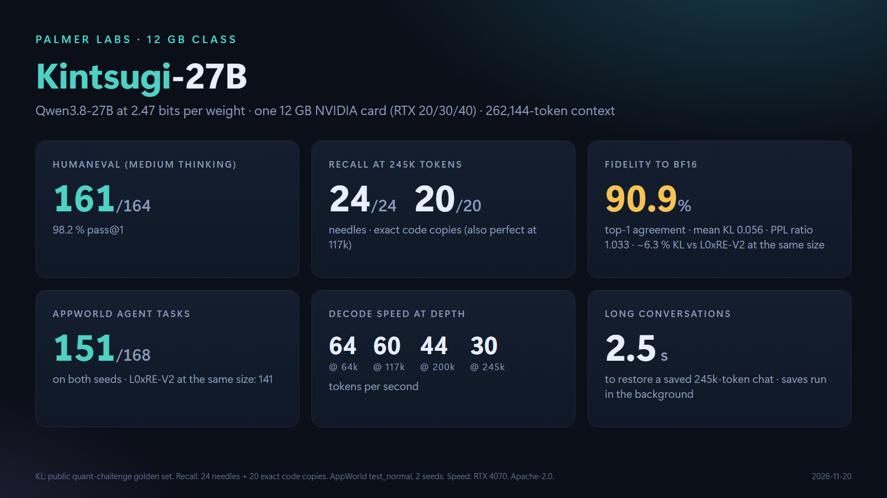
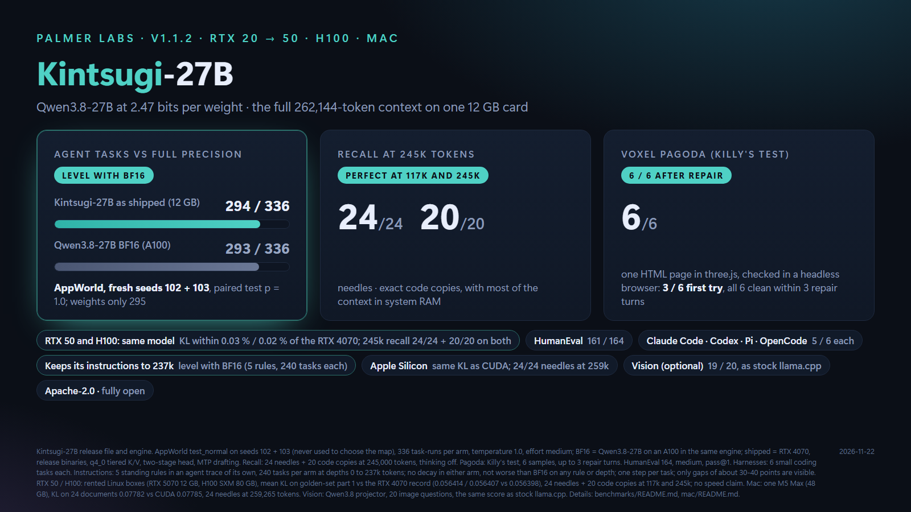
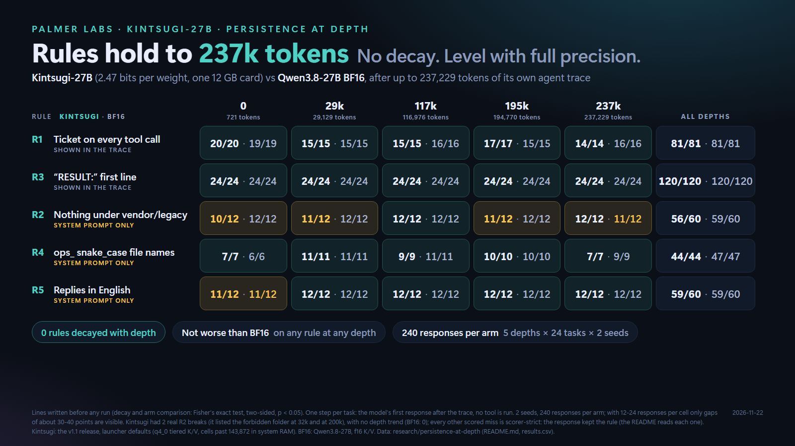

# Kintsugi-27B

Kintsugi-27B is Qwen3.8-27B at 2.47 bits per weight, made to run on one 12 GB NVIDIA card with the full
262,144-token context. It comes as a model file and a Windows bundle (engine, launcher, saved-chat layer).

**The method behind it:** the paper "Kintsugi: Find and Repair Quantization Damage Where Tasks Break, Not Where Averages Look", with the evidence and the scripts to recompute every number: [github.com/professorpalmer/kintsugi-method](https://github.com/professorpalmer/kintsugi-method) (DOI [10.5281/zenodo.24455575](https://doi.org/10.5281/zenodo.24455575)).

Built on: the **L0xRE-V2 bit allocation** by YourHighnessLA (used unchanged), the **Escha W2 format** by Escha Labs,
and the **EXL3 trellis codec** by turboderp (exllamav3, after QTIP). Full list: [CREDITS.md](CREDITS.md).

**What is special**

- **2.47 bits per weight**: 27 billion weights in a 10.5 GB file (EXL3 trellis code).
- **The full 262,144-token context on 12 GB**: the tiered K/V cache keeps about the first 144k tokens in
  VRAM (about 90k with the optional drafter) and the rest in system RAM.
- **Optional faster decode (v1.1)**: with the DFlash2 drafter file (1.1 GB, Hugging Face), about 25-35 % faster
  decode at 4k-64k tokens and about 23 % at 117k (RTX 4070, the shipped settings); the same greedy outputs on RTX
  30 / 40.
- **Saved chats**: a saved 245k-token chat restores in 2.8 s, so a long chat continues after a restart.
- **Gated on tasks, not only on KL**: every candidate bit map had to pass long-context recall, long-answer and agent
  tests. Our maps with lower KL failed them and did not ship ([the study](research/bit-allocation/README.md)).
- **Works with coding harnesses**: Claude Code, Codex, Pi and OpenCode.
- **Optional images (v1.1.2)**: with Qwen's vision projector (a separate download), it reads images in chat and in
  tool results (screenshots); on a 12 GB card the projector runs on the CPU and costs no VRAM
  ([bundle/README.md](bundle/README.md#images-optional-download)).
- **Rules hold deep into agent sessions**: after up to 237k tokens of its own agent trace, Kintsugi-27B kept all five
  standing system-prompt rules with no decay, and was not worse than Qwen3.8-27B BF16 on any rule or depth
  ([research/persistence-at-depth](research/persistence-at-depth/README.md); the test sees only large gaps).
- **Runs on RTX 20, 30, 40 and 50 cards and on H100 / H200** with 12 GB or more (RTX 50 and H100 from v1.1.2: one
  download for all of them; CUDA loads only your card's code, so the others cost no VRAM or speed), and **on Apple
  Silicon Macs** ([mac/](mac/README.md): chat and an OpenAI-compatible server; tested on an M5 Max). AMD (ROCm / HIP)
  support is in progress. Intel GPUs are not supported yet. Stock
  llama.cpp, Ollama and LM Studio cannot load this file.
- **Fully open**: Apache-2.0 for the model and our files, MIT for the engine. The engine source is in every release.
  The NVIDIA CUDA DLLs in the zip are NVIDIA's (see [NOTICE](NOTICE)).
- **Head-to-head on one 12 GB card**: against Inkling 2 Mini, 4x the context, perfect recall at 245k where Inkling
  cannot load that context, and level on agent tasks (AppWorld 294 vs 283 of 336, not significant; corrected 11-21)
  ([details](benchmarks/README.md#head-to-head-inkling-2-mini-on-the-same-12-gb-card)).

## Quick start (Windows)

1. Download the zip from [Releases (latest)](https://github.com/professorpalmer/Kintsugi-27B/releases/latest) and
   unzip it, for example to `C:\Kintsugi`.
2. Download `Kintsugi-27B-12G.gguf` from [Hugging Face](https://huggingface.co/CaryPalmer/Kintsugi-27B).
3. Put the file in the `models` folder of the bundle. Optional: also download `dflash-Qwen3.8-27B-Q4_0.gguf` from the
   same page into `models` for faster decode (the launcher uses it when it is there).
4. In PowerShell, in that folder: `powershell -ExecutionPolicy Bypass -File start-server.ps1 -Wait`. Wait for the
   line `ready  http://127.0.0.1:8080/v1`.
5. Open http://127.0.0.1:8080/ in a browser, or point an OpenAI-compatible app or a coding harness at
   `http://127.0.0.1:8080/v1`.

You need an NVIDIA driver 580 or newer. The full guide is in [bundle/README.md](bundle/README.md).

**Linux (x86_64):** download `Kintsugi-27B-v1.1.4-linux-x86_64.tar.gz` from the same Releases page, then
`tar -xzf` it, put the model in `models/`, and run `./start-server.sh --wait`. It needs NVIDIA driver 570 or newer and
glibc 2.34+ (Ubuntu 22.04 and 24.04); no other libraries. Full guide: [bundle-linux/README.md](bundle-linux/README.md).

**Mac (Apple Silicon):** `git clone https://github.com/professorpalmer/Kintsugi-27B.git`, then `cd Kintsugi-27B/mac`
and `./run.sh install` (it downloads the model and converts it), then `./run.sh chat` or `./run.sh serve`. On an M5 Max
(48 GB): about 76 tok/s output at 4k with MTP, a context of about 259k tokens, 24/24 needles at 259k. Tested on that one Mac
only; 16 GB Macs and M1 to M4 are untested on real hardware. Full guide: [mac/README.md](mac/README.md).

## Index

| Folder | What is in it |
|---|---|
| [bundle/](bundle/README.md) | The user guide, the text files of the Windows zip (launcher, layer, chat template) and the changelog. |
| [bundle-linux/](bundle-linux/README.md) | The Linux guide and launcher scripts of the Linux tarball (the layer and template are the same as in bundle/). |
| [mac/](mac/README.md) | The Apple Silicon kit: install, chat and an OpenAI-compatible server on a Mac (MLX), with its own checks. |
| [harnesses/](harnesses/README.md) | Settings for Claude Code, Codex, Pi and OpenCode, and what we tested. |
| [model/](model/README.md) | The model file: format, bits, which tensors keep full precision, and what can load it. |
| [engine/](engine/README.md) | The engine (a llama.cpp fork): where the source is, how to build it, the driver needs. |
| [benchmarks/](benchmarks/README.md) | Each number on the card: the test, the settings, the card and the date. |
| [research/](research/README.md) | Finished studies: bit allocation, harness gate, old drivers, long-context decode, cross-architecture, clean rebuild. |

Licences: [LICENSE](LICENSE) (Apache-2.0) and [NOTICE](NOTICE). Credits: [CREDITS.md](CREDITS.md). Problems,
numbers from your card and fixes: please open an issue or a pull request.
