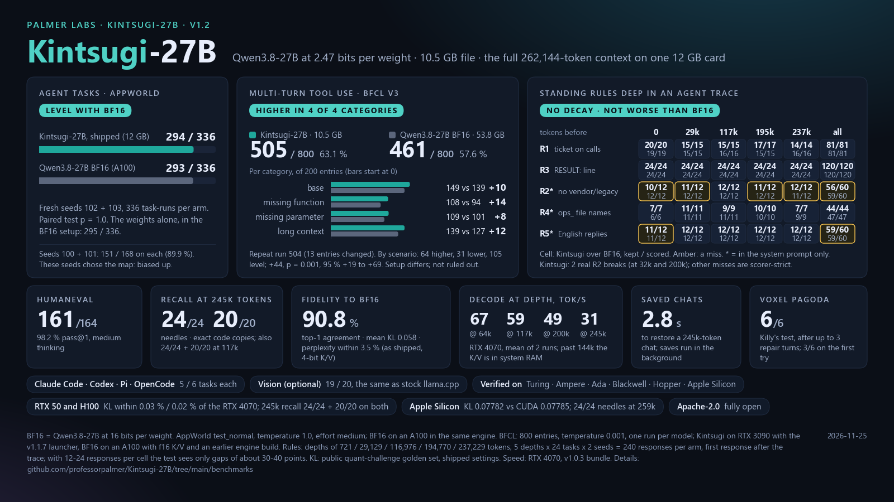

# Kintsugi-27B

Kintsugi-27B is Qwen3.8-27B at 2.47 bits per weight. It runs on one 12 GB NVIDIA card with the full 262,144-token
context. You get a model file, a bundle for Windows and Linux (engine, launcher, saved-chat layer) and a Mac kit.

**Method:** the paper "Kintsugi: Find and Repair Quantization Damage Where Tasks Break, Not Where Averages Look", with
the evidence and the scripts for every number:
[github.com/professorpalmer/kintsugi-method](https://github.com/professorpalmer/kintsugi-method) (DOI
[10.5281/zenodo.24455575](https://doi.org/10.5281/zenodo.24455575)).

**Built on:** the **L0xRE-V2 bit allocation** by YourHighnessLA (used unchanged), the **Escha W2 format** by Escha
Labs, and the **EXL3 trellis codec** by turboderp (exllamav3, after QTIP). Full list: [CREDITS.md](CREDITS.md).

## Results

| Test | Kintsugi-27B | Note |
|---|---|---|
| AppWorld agent tasks (fresh seeds 102 + 103) | **294 / 336** | BF16: 293. Level (p = 1.0). |
| BFCL v3 multi-turn tool use | **505 / 800** | BF16: 461. Higher in all 4 categories. One run each; setup differs ([details](benchmarks/bfcl/README.md)). |
| System-prompt rules after up to 237k tokens of its own agent trace | **5 / 5 kept, no decay** | Not worse than BF16. The test sees only large gaps ([study](research/persistence-at-depth/README.md)). |
| HumanEval (medium thinking) | **161 / 164** | |
| Recall at 245k tokens | **24 / 24 needles, 20 / 20 code copies** | |
| Fidelity to BF16 (public golden set) | **top-1 90.8 %, mean KL 0.058** | Perplexity ratio 1.035. |
| Decode, RTX 4070, at 64k / 117k / 200k / 245k | **67 / 59 / 49 / 31 tok/s** | First read of 245k: 589 tok/s (414 s). About 11.6 GB VRAM, no spill. |
| Restore a saved 245k-token chat | **2.8 s** | |
| Claude Code, Codex, Pi, OpenCode | **5 / 6 tasks each** | [Settings](harnesses/README.md). |
| Images (optional projector) | **19 / 20** | The same as stock llama.cpp. |

BF16 = full-precision Qwen3.8-27B. Decode: launcher defaults (MTP + lookup), thinking off, 400 tokens, mean of three
prompts, a fresh server for each depth. Every test and setting: [benchmarks/README.md](benchmarks/README.md).

**RTX 3060 12 GB (Debian 13), measured by Doğukan Ürker** ([@DogukanUrker](https://github.com/DogukanUrker),
[#15](https://github.com/professorpalmer/Kintsugi-27B/issues/15)): 11.6 GB at every depth, no spill. Decode 33.2 /
31.6 / 25.6 / 16.8 tok/s (41.5 short). First read of 245k: 265 tok/s (922 s). HumanEval 161, 160 and 161 / 164 in three
runs. His own needles and code copies: all correct at 117k, 245k and 258k. That card has about half the memory
bandwidth of the RTX 4070, so decode is about half as fast. 16 GB of system RAM was enough with other programs closed.

## Quick start (Windows)

1. Download the zip from [Releases (latest)](https://github.com/professorpalmer/Kintsugi-27B/releases/latest) and
   unzip it, for example to `C:\Kintsugi`.
2. Download `Kintsugi-27B-12G.gguf` from [Hugging Face](https://huggingface.co/CaryPalmer/Kintsugi-27B) into the
   `models` folder. Optional: add `dflash-Qwen3.8-27B-Q4_0.gguf` from the same page for faster decode.
3. In PowerShell, in that folder: `powershell -ExecutionPolicy Bypass -File start-server.ps1 -Wait`. Wait for
   `ready  http://127.0.0.1:8080/v1`.
4. Open http://127.0.0.1:8080/, or point an OpenAI-compatible app or coding harness at `http://127.0.0.1:8080/v1`.

You need NVIDIA driver 580 or newer and a CPU with AVX2, or with AVX + F16C (Intel 2012 or newer: the launcher
picks the matching CPU library by itself, v1.2.1). Full guide: [bundle/README.md](bundle/README.md).

- **Reasoning effort (v1.2, optional):** `KINTSUGI_EFFORT` = `medium` (default), `xhigh` or `low`; on Windows also
  `-Effort xhigh` ([details](bundle/README.md#reasoning-effort-optional)).
- **Saved chats** go to `slots`, up to 20 GB by default (`KINTSUGI_SLOT_CACHE_GB`). Move them with
  `KINTSUGI_SLOT_SAVE_PATH`. Turn saving off with `KINTSUGI_LAYER=0`.

**Linux (x86_64):** download `Kintsugi-27B-v1.2.1-linux-x86_64.tar.gz` from Releases, unpack it with `tar -xzf`, put the
model in `models/` and run `./start-server.sh --wait`. Needs NVIDIA driver 570+ and glibc 2.34+ (Ubuntu 22.04 / 24.04),
no other libraries. Guide: [bundle-linux/README.md](bundle-linux/README.md).

**Mac (Apple Silicon):** `git clone https://github.com/professorpalmer/Kintsugi-27B.git`, `cd Kintsugi-27B/mac`,
`./run.sh install` (downloads and converts the model), then `./run.sh chat` or `./run.sh serve`. On an M5 Max (48 GB):
about 76 tok/s at 4k with MTP, about 259k tokens of context, 24/24 needles at 259k. Only that Mac is tested; 16 GB Macs
and M1 to M4 are not. Guide: [mac/README.md](mac/README.md).

## Hardware and engine

- **NVIDIA RTX 20 / 30 / 40 / 50 and H100 / H200** with 12 GB or more (RTX 50 and H100 from v1.1.2). One download for
  all; CUDA loads only your card's code, so the rest costs no VRAM or speed.
- **CPU:** AVX2 (Intel Haswell 2013 / AMD Zen or newer), or AVX + F16C (for example Intel Ivy Bridge 2012) with the
  second CPU library that the launchers pick by themselves (v1.2.1, #21). The GPU does nearly all of the work.
- **Apple Silicon Macs:** see [mac/](mac/README.md). **AMD (ROCm / HIP):** release candidate
  [amd-rc1](https://github.com/professorpalmer/Kintsugi-27B/releases/tag/amd-rc1) (Windows and Linux, RDNA3 and RDNA4);
  test reports are welcome. **Intel GPUs:** not yet.
- The file needs our engine (a llama.cpp fork, in every bundle). Stock llama.cpp, Ollama and LM Studio cannot load it.

<b>How it works</b>

- **2.47 bits per weight:** 27 billion weights in a 10.5 GB file (EXL3 trellis code).
- **262,144 tokens on 12 GB:** the tiered K/V cache keeps about the first 144k tokens in VRAM (about 90k with the
  drafter) and the rest in system RAM.
- **DFlash2 drafter (optional, v1.1, 1.1 GB):** about 25-35 % faster decode at 4k-64k tokens and about 23 % at 117k
  (RTX 4070, shipped settings). The greedy outputs stay the same on RTX 30 / 40.
- **Gated on tasks, not only on KL:** every candidate bit map had to pass long-context recall, long-answer and agent
  tests. Our maps with lower KL failed them and did not ship ([study](research/bit-allocation/README.md)).
- **Images (optional, v1.1.2):** Qwen's vision projector (a separate download) reads images in chat and in tool results.
  On a 12 GB card it runs on the CPU and costs no VRAM ([guide](bundle/README.md#images-optional-download)).

<b>Folders</b>

| Folder | Contents |
|---|---|
| [bundle/](bundle/README.md) | User guide, Windows launcher, layer, chat template, changelog. |
| [bundle-linux/](bundle-linux/README.md) | Linux guide and launcher (layer and template as in bundle/). |
| [mac/](mac/README.md) | Apple Silicon kit (MLX): install, chat, server, checks. |
| [harnesses/](harnesses/README.md) | Settings for Claude Code, Codex, Pi and OpenCode; what we tested. |
| [model/](model/README.md) | The model file: format, bits, full-precision tensors, what can load it. |
| [engine/](engine/README.md) | The engine (a llama.cpp fork): source, build, driver needs. |
| [benchmarks/](benchmarks/README.md) | Every number: test, settings, card, date. Also the earlier cards. |
| [research/](research/README.md) | Finished studies: bit allocation, harness gate, old drivers, long-context decode, cross-architecture, clean rebuild. |

## Licence and credits

Apache-2.0 for the model and our files ([LICENSE](LICENSE)), MIT for the engine. The engine source is in every
release. The NVIDIA CUDA DLLs in the zip are NVIDIA's ([NOTICE](NOTICE)).

Thanks to the Qwen team, turboderp (exllamav3), the QTIP authors, Escha Labs, YourHighnessLA (L0xRE), StillDeadcode
(quant challenge), Ajay9o9, Aldehir Rojas (llama.cpp #32381), Inco AI (DFlash2), the llama.cpp / ggml contributors and
many more: [CREDITS.md](CREDITS.md). Issues and pull requests are welcome.

Tested and reported by: Lazm, Abdelrahman Waref, Mustafa YILDIRIM, loadnl and luluijn (AMD builds); Amel,
Doğukan Ürker, xgxx666, hyf03288, XeonG and Killy (reports, tests and fixes). Thank you. What each person did is in
[CREDITS.md](CREDITS.md). If we missed you, tell us.
