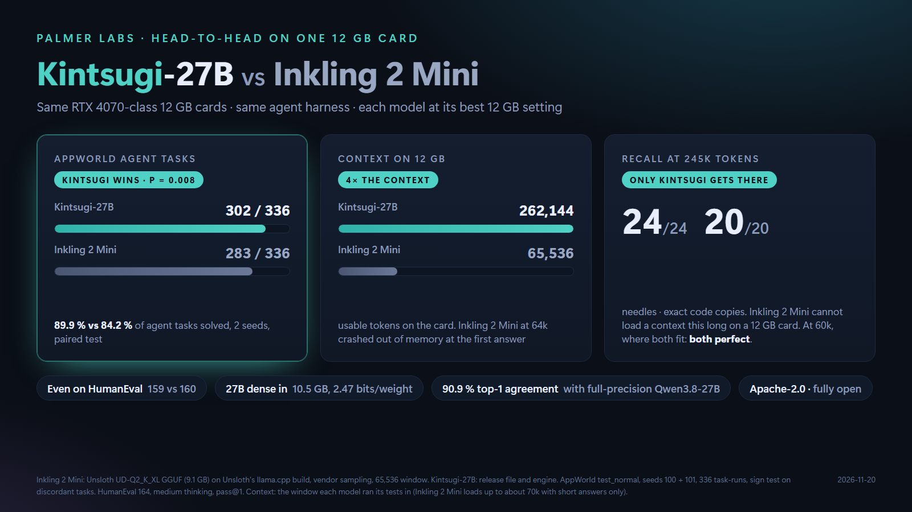

# Benchmarks: the numbers on the card

All results below are for Kintsugi-27B on our own engine. Some rows were measured on an earlier fit of ours in the
same format (2.47 bits per weight, within 0.1 % of the same size). Those rows say so. Speed and memory depend on the
format, the engine and the card, not on the fit. The model file of the release is `Kintsugi-27B-12G.gguf` (sha256
`0510bae82445dc53dbc7d0d842d8b7e146b8eafce0837e39b157d411e48c8a74`).

**Rig:** one RTX 4070 12 GB, Windows 11, display on the integrated GPU, NVIDIA driver 580+ family, MSI Afterburner
memory profile (`nvidia-smi clocks.mem` 11,751 MHz under load).

**Launcher settings ("deep" profile = the bundle's defaults):** window 262,144 tokens, K/V cache q4_0, 143,872 K/V
cells in VRAM, two-stage head, MTP draft 3 + lookup drafting, int8 fast read, micro-batch 1,024.

| Card number | Test and set | Settings | Card | Date | Result |
|---|---|---|---|---|---|
| HumanEval 161/164 | HumanEval (OpenAI), all 164 problems; pass@1, one answer for each problem | Plain server (no layer), thinking on with effort "medium", up to 24,576 output tokens, the server's default sampling from the model file (temperature 1.0, top-k 20, top-p 0.95) | RTX 4070 (rig) | 2026-11-20 | **161 / 164 (98.2 %)** |
| Recall at 245k: 24/24 + 20/20 | 24 needle questions (a fact planted in a long text) and 20 exact copies of a code function, each at a depth of 245,000 tokens | Thinking off, launcher defaults | RTX 4070 (rig) | 2026-11-20 | **24 / 24 needles, 20 / 20 copies** |
| "also perfect at 117k" | The same 24 + 20 at 117,000 tokens | Another launcher profile (131,072-token window, a DFlash drafter; not in the bundle), thinking off | RTX 4070 (rig) | 2026-11-20 | **24 / 24, 20 / 20** |
| Fidelity to BF16: 90.9 %, KL 0.056, PPL within 3.3 % | The golden BF16 set of the Qwen3.8-27B quant challenge (StillDeadcode, CC BY 4.0): 295 public documents, 376,086 scored tokens; its KL scorer, ported to our engine | K/V q8_0, all K/V in VRAM, batch 256, scored on generated positions only | RTX 4070 (rig) | 2026-11-20 | **same top token 90.934 %, mean KL 0.056398, perplexity ratio 1.0332** |
| AppWorld 151/168 | AppWorld test_normal (168 tasks), simplified ReAct code agent | Temperature 1.0, effort "medium", 50 steps, seeds 100 and 101; plain server, launcher defaults | Rented RTX 4070 boxes (Linux; quality only, no speed) | 2026-11-20 | **151 / 168 on seed 100 and 151 / 168 on seed 101** (89.9 %). A rerun of seed 101 on another box gave the same 168 outcomes. |
| Decode 64 / 60 / 44 / 30 tok/s | Decode speed at 64k / 117k / 200k / 245k tokens of context: 400 tokens on each of 3 prompts (code, prose, bash), mean of the 3; a fresh server for each depth | Launcher defaults (MTP draft 3 + lookup). An earlier fit of ours in the same format, on the engine build just before the release engine. On a short check, the release engine gave the same output token for token and the same speed (76.2 vs 76.4 tok/s). | RTX 4070 (rig) | 2026-11-19 | **64.3 / 60.3 / 44.1 / 30.5 tok/s.** Past 143,872 tokens, the K/V cells are in system RAM and stream over PCIe at each step. That is why 200k and 245k are slower. Cold read of a 245k prompt: 589 tok/s (414 s). |
| Long conversations: 2.5 s | Restore a saved 245,935-token chat after a restart of the server and the layer, then the next turn | Layer on, launcher defaults. An earlier fit of ours in the same format | RTX 4070 (rig) | 2026-11-19 | **Restore 2.49 s; first token of the next answer 9.7 s** (a cold read of 245k takes about 414 s); the same answer as before the restart |
| Works with: Claude Code, Codex, Pi, OpenCode | 6 small coding tasks in a small Python repository (see [harnesses/](../harnesses/README.md)) | Bundle v1.0.2 template; through the saved-chat layer and with the plain server | RTX 4070 (rig) | 2026-11-20 | **5 / 6 in each harness, on both paths**; no malformed tool calls, no leaked tags, no loops |

## Checks on each GPU architecture

These checks show that the kernels compute the same model on each architecture. Speeds from rented boxes are not
comparable with the rig (other drivers, clocks and hosts). We make no speed claims from them.

| Architecture | Card | What we checked | Result |
|---|---|---|---|
| Ada (sm_89) | RTX 4070 12 GB (rig) | Everything in the table above | See above |
| Ampere (sm_86) | RTX 3060 12 GB (rented box) | KL on the same golden set against the rig, on the same model file (an earlier fit of ours in the same format); needles at 117k | Mean KL +0.92 % against the rig (line: within 2 %), same top token 91.215 % against 91.276 %; needles 24 / 24 |
| Turing (sm_75) | Quadro RTX 6000, held to a 12 GB limit (the same kernels and memory path as an RTX 2060 12 GB; rented boxes) | KL of the release file; needles and code copies at 117k; no memory spill at the 12 GB limit | Mean KL 0.056409 against the rig's 0.056398 (+0.02 %), same top token 90.933 % against 90.934 %; 24 / 24 needles, 20 / 20 copies; 0 spill, 0 out-of-memory |

On Turing and Ampere, the output is not token-identical to the RTX 4070 in every case, because rounding differs between
architectures. KL is the test that decides.

## Head-to-head: Inkling 2 Mini on the same 12 GB card

We ran Kintsugi-27B and Inkling 2 Mini on the same type of card, with the same harness, on 2026-11-20. All runs used
rented RTX 4070-class 12 GB boxes (Linux).

**The two setups**

| | Kintsugi-27B | Inkling 2 Mini |
|---|---|---|
| Model | Qwen3.8-27B at 2.47 bits per weight (this release) | Thinking Machines, 26.4B looped MoE, Apache-2.0 |
| File | `Kintsugi-27B-12G.gguf` (the release file) | Unsloth's UD-Q2_K_XL GGUF, 9,138,715,328 bytes |
| Engine | The Kintsugi engine of the release | Unsloth's llama.cpp source release b12588-mix-c0c3de8, built from source. Stock llama.cpp cannot load this model yet. |
| Sampling | As for the card numbers above (temperature 1.0) | The vendor's: temperature 1.0, top-p 1.0, top-k 0, min-p 0 |
| Window and K/V | Up to 262,144 tokens on 12 GB (tiered K/V cache) | 65,536 tokens, f16 K/V |

**Results**

| Test | Kintsugi-27B | Inkling 2 Mini | Verdict |
|---|---|---|---|
| AppWorld test_normal, seeds 100 and 101 (336 task-runs) | **302 / 336** (89.9 %) | 283 / 336 (84.2 %) | Kintsugi is better. Paired sign test on the discordant tasks: 14 vs 33, p = 0.0079. |
| HumanEval 164, medium thinking, pass@1 | 159 / 164 | 160 / 164 | Even (discordant 4 vs 3, p = 1.00). |
| Retrieval at depth 60,000 (24 needles + 20 exact code copies) | 24 / 24 and 20 / 20 | 24 / 24 and 20 / 20 | Even. |
| Retrieval at depth 64,000 | 24 / 24 and 20 / 20 | Stopped with CUDA out of memory at the first decode (67,584-token window) | Only Kintsugi. |
| Retrieval at depth 117,000 and 245,000 | 24 / 24 and 20 / 20 at each depth | Cannot load a window this long on 12 GB | Only Kintsugi. |
| Context on 12 GB | 262,144 tokens | Tests ran at 65,536. It loads up to about 70k, with short answers only. q8_0 K/V does not fit, even at 32k. | Kintsugi has 4x the context. |

The HumanEval number on the card (161) is from the home RTX 4070. Here, 159 is the same model on the rented box. This
difference is normal run-to-run spread.

**Fairness notes**

- Inkling 2 Mini has no switch to turn thinking off. Thus its retrieval ran at its lowest effort ("none"), with 1,024
  more answer tokens than Kintsugi had. This helps Inkling a little.
- One Inkling AppWorld run went past its 65,536-token window (1 of 336).
- We logged each change to a setting before we saw its result.

**What this does NOT claim**

- Thinking Machines published results at full precision. We do not compare with those results.
- This compares the two models on one 12 GB card, which is where most people run them.
- We give no speed numbers, because rented boxes are not comparable for speed.
