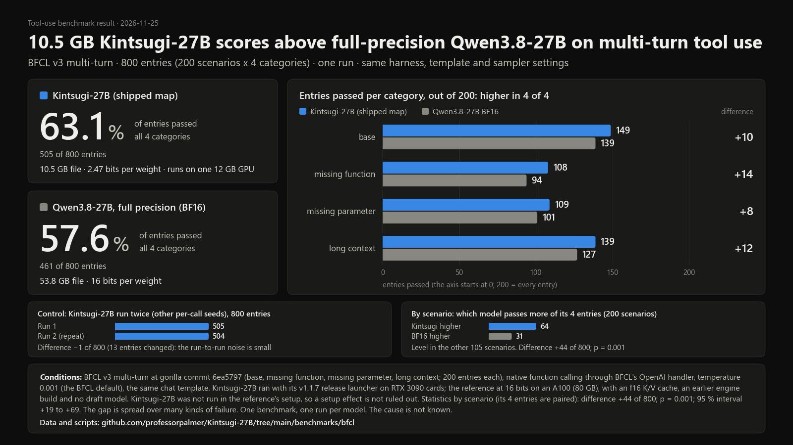

# BFCL multi-turn: Kintsugi-27B and full-precision Qwen3.8-27B



We ran the Berkeley Function Calling Leaderboard (BFCL) v3 multi-turn tasks on Kintsugi-27B and on the model it is
made from, Qwen3.8-27B at full precision (BF16). The runs were made on 2026-11-24 and 2026-11-25. This is our own
measurement of our own model and its base model.

## Result

| Category (200 entries each) | Kintsugi-27B | Qwen3.8-27B BF16 | Difference |
|---|---:|---:|---:|
| base | 149 | 139 | +10 |
| missing function | 108 | 94 | +14 |
| missing parameter | 109 | 101 | +8 |
| long context | 139 | 127 | +12 |
| **All 800 entries** | **505 (63.1 %)** | **461 (57.6 %)** | **+44** |

- **Statistics by scenario.** The 4 entries of a scenario (the same index in the 4 categories) are paired.
  Difference +44 of 800; sign-flip p = 0.0011; 95 % interval +19 to +69. Kintsugi-27B passes more entries in 64
  scenarios, BF16 in 31, and the two are level in 105.
- **Run-to-run noise.** A second run of Kintsugi-27B with other per-call seeds passes 504 (difference −1 of 800;
  13 entries changed).
- **The gap is not one habit.** It is spread over many kinds of failure: wrong final state, a text reply where a call
  was needed, and wrong responses. The largest kind carries about a quarter of the gap.

## Settings

| | Kintsugi-27B | Qwen3.8-27B BF16 (reference) |
|---|---|---|
| Model file | `Kintsugi-27B-12G.gguf` (the release file, 2.47 bits per weight) | `Qwen3.8-27B-BF16.gguf` from ggml-org (53,808,282,240 bytes) |
| Engine | The v1.1.7 release engine and launcher, launcher defaults (q4_0 K/V, two-stage head, MTP + lookup drafting) | An earlier build of the same engine (commit af70fc544), f16 K/V, no drafting, no two-stage head |
| Card | Rented RTX 3090 (24 GB). At these prompt lengths the K/V cache sits in VRAM as on a 12 GB card. | Rented A100 SXM4 (80 GB) |
| Same for both | Chat template (`templates/kintsugi.jinja` of the release), the release layer in front of the server, reasoning effort "medium", thinking budget 20,480 tokens, the client below | |

**BFCL:** gorilla `berkeley-function-call-leaderboard` at commit `6ea57973c7a6097fd7c5915698c54c17c5b1b6c8`, the four v3
multi-turn categories (800 entries). Native function calling: BFCL's official `OpenAICompletionsHandler` sends the
functions as OpenAI `tools` to `/v1/chat/completions`, and the server returns `tool_calls`. Temperature 0.001 (the BFCL
default). Scoring is the official `bfcl evaluate`.

**Our changes to the client** (see [bfcl_run.py](bfcl_run.py); everything else is the official code):
- Each model call sends its own seed (from the entry id and the call index), so no two calls share a seed.
- The reasoning text of each reply is copied into the result file, for reading only.
- The client timeout can be set. The default of the OpenAI SDK is 600 s per request. BF16 on the A100 decodes at about
  28 tokens per second, so two of its long calls timed out. We ran those 2 entries again with a 3,600 s timeout
  (one now passes; Kintsugi-27B fails the other one too). The table uses the repaired run.

## What this does not show

- **A setup effect is not ruled out.** The reference ran on a different card, cache precision and engine build, with no
  drafting. We did not run Kintsugi-27B in the reference's exact setup.
- **One benchmark, one run per model,** at one sampler setting. The cause of the gap is not known.

## Check the numbers

The per-entry results are in this folder (`id`, `pass`; 1 = the official evaluator passed the entry):
[kintsugi-27b.csv](kintsugi-27b.csv), [kintsugi-27b-repeat.csv](kintsugi-27b-repeat.csv),
[qwen3.8-27b-bf16.csv](qwen3.8-27b-bf16.csv). With Python 3 and numpy:

```
python bfcl_stats.py
```

It prints the table, the scenario counts, the p value and the interval above.

## Credits

BFCL is made by the Gorilla team at UC Berkeley (Apache-2.0). Qwen3.8-27B is made by the Qwen team.
