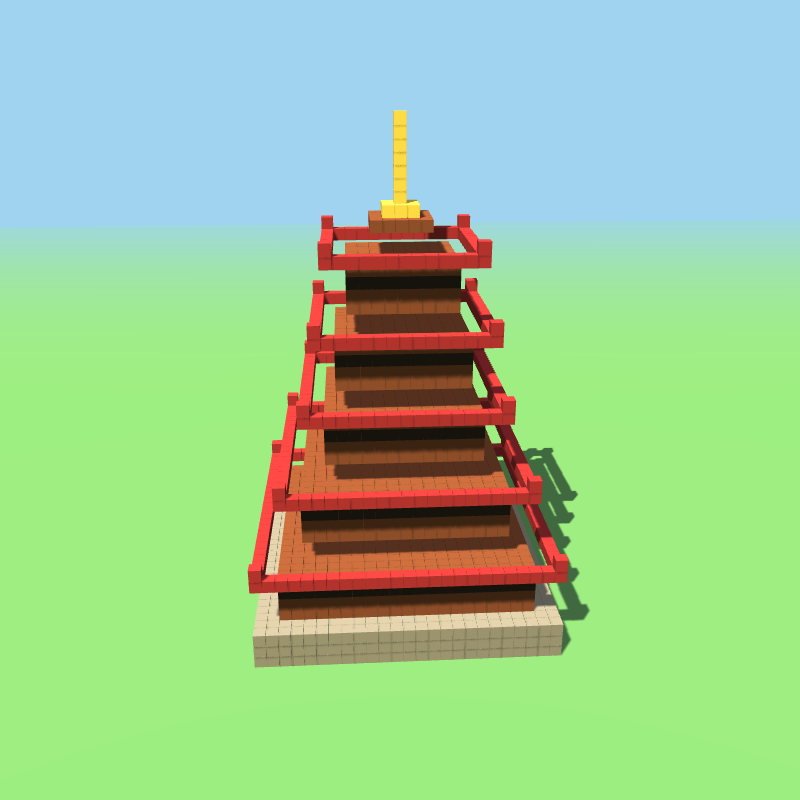
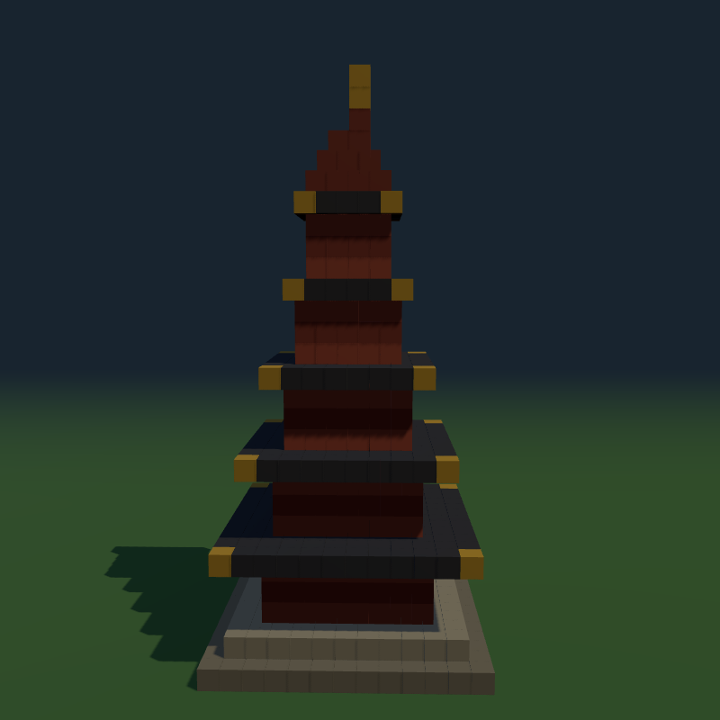
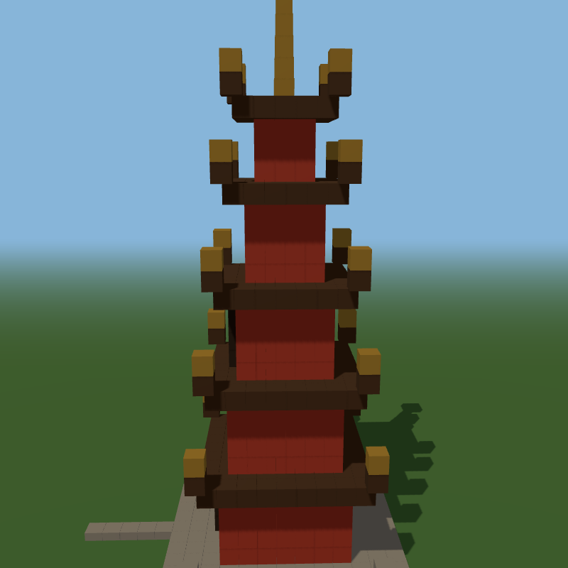
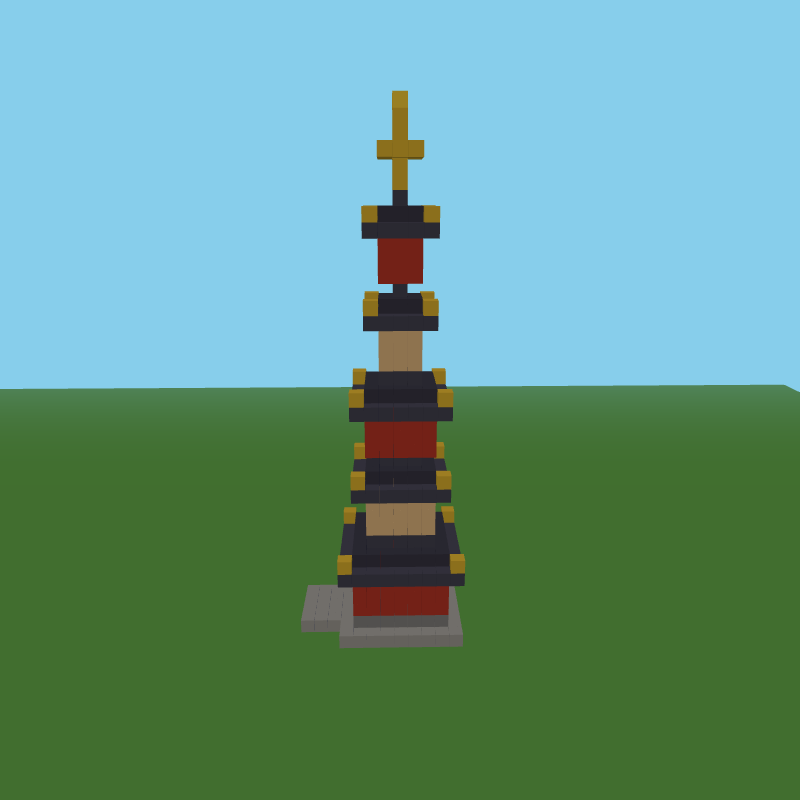
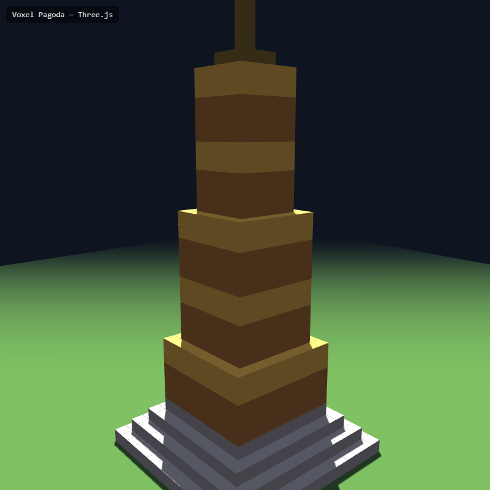
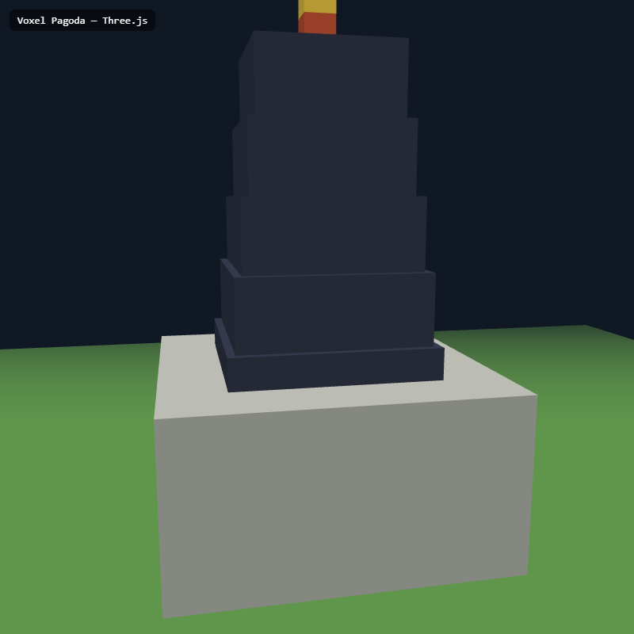

# Voxel pagoda test (Killy's test)

A one-shot creative coding task from Killy: write one self-contained HTML page that draws a five-tier voxel pagoda
in three.js (box voxels only, a ground plane, lights, an orbiting camera). The page is opened in a headless browser
and screenshotted after 6 seconds. A probe checks the page and reports only facts: console errors, dead URLs, no
mesh drawn, voxels that hang in the air, and a structure outside the camera's view. A page with none of these is
"clean".

If a page is not clean, the probe's facts go back to the model in a follow-up turn ("I ran your page..."), and the
model returns a fixed page. The probe never says how to fix anything. Up to 3 repair rounds.

## Result (2026-11-21)

Kintsugi-27B v1.1 Windows bundle, launcher defaults, thinking effort medium, server-default sampling, 6 samples.

| | Count |
|---|---|
| Clean on the first try | **3 / 6** |
| Clean after one repair | **5 / 6** |
| Clean after three repairs | **6 / 6** |

Every page rendered, with 0 console errors in every round. Every first-try fault was floating voxels.

The probe does not check style. By eye, 4 of the 6 final pages are clear five-tier voxel pagodas (s0, s1, s3, s4).
s2 and s5 pass the probe, but they are weak as pagodas: s2 has no separate roofs, and s5 uses large boxes, not
voxels. n = 6 is small: a difference of 1-2 pages between models is within noise.

| Sample | First try | Clean at round | Final page (open it in a browser) | Screenshot |
|---|---|---:|---|---|
| s0 | 699 of 1,341 voxels floating | 2 | [s0-final.html](s0-final.html) | [final](s0-final.png), [first try](s0-first-try.png) |
| s1 | clean | 0 | [s1-final.html](s1-final.html) | [final](s1-final.png) |
| s2 | 618 of 1,134 voxels floating | 1 | [s2-final.html](s2-final.html) | [final](s2-final.png), [first try](s2-first-try.png) |
| s3 | clean | 0 | [s3-final.html](s3-final.html) | [final](s3-final.png) |
| s4 | clean | 0 | [s4-final.html](s4-final.html) | [final](s4-final.png) |
| s5 | 2 of 34 voxels floating | 1 | [s5-final.html](s5-final.html) | [final](s5-final.png), [first try](s5-first-try.png) |

The pages load three.js from unpkg.com, so they need an internet connection.

## The best page: s1 (clean on the first try)

## The other final pages

| s0 (after 2 repairs) | s3 | s4 |
|---|---|---|
|  |  |  |

| s2 (after 1 repair; weak) | s5 (after 1 repair; weak) |
|---|---|
|  |  |

Thanks to Killy for the test.
